# Nubandina Coffee

**Demo**

A Shopify coffee store with a self-hosted n8n order backend, in English and Spanish. The backend handles each order once. It logs a Google Sheets row, emails the owner, alerts on low stock, and later emails the customer a brewing guide in the customer's language. It's built with a strict TypeScript toolchain and runs locally in Docker.


How it works, how it fails, and why it's built this way: [docs/architecture.md](docs/architecture.md). For the full-size, interactive diagram, open [`docs/diagrams/architecture.html`](docs/diagrams/architecture.html) from a local clone in a browser.

## Status

The build is complete and verified offline, through tests, workflow and theme checks, and runs against the local n8n instance. Checks that need a live Shopify store, the Google account, the tunnel, or queue mode are listed under "Live checks (pending)" below.

## What works now

Each item below was verified offline.

**Runtime and tooling**

- `pnpm run typecheck`, `pnpm run lint`, and `pnpm test` pass. CI runs them, with the workflow, theme, and security checks, on every pull request. A separate `n8n` CI job boots the real n8n 2.45.6 and Postgres, runs `pnpm run setup`, runs `node scripts/check-db.ts`, and calls the dev harness's `load-config` and `intake-order` targets, proving the published workflow chain — including two generated Code nodes and a least-privilege Postgres write — actually executes, with no Shopify, Google, or Gmail credential needed. That call's fixture order carries `customer_locale: "es-CO"`, and the check requires `Normalize order` to return it as `es`.
- Supply-chain hardening: pnpm with a release-age gate, trust-policy enforcement, blocked exotic sub-dependencies, and build-script approval (`pnpm-workspace.yaml`); every Compose image pinned by digest; a Dependabot cooldown on every ecosystem — see AGENTS.md's "Supply-chain hardening" section.
- Docker Compose runs Postgres 17 and n8n 2.45.6, published on `127.0.0.1` only.
- Databases `app` and `n8n` each belong to their own role, and neither role can open the other's database. n8n's own Postgres node never connects as the app role; it connects as `app_runtime`, a least-privilege role with `SELECT, INSERT` on `orders` only, maintained by `pnpm run db:migrate` and proved by `node scripts/check-db.ts` — see [docs/database.md](docs/database.md).
- n8n mounts the config, the brewing guides, and the workflows read-only.
- Queue mode (`compose.queue.yaml`) brings up Redis and two `n8n-worker` containers, all healthy.
- `pnpm run setup` validates the config, imports credentials without printing them, and publishes the workflows. Running `setup` and `export` a second time leaves `workflows/` unchanged.
- Credential import streams the decrypted JSON into the n8n container over stdin, and the existing-credentials check reads the (still encrypted) export back over stdout — neither ever touches the host filesystem or the `.n8n-import/` bind mount. This fixes two Linux-only failures: the runner's uid (1001) writing a file n8n's own uid (1000) couldn't read, and the reverse, n8n's uid writing a file the runner couldn't `chmod` or delete. After a publish, `pnpm run setup` waits for `/healthz`, 15 more seconds for the publication reconciler, then polls the dev harness's own webhook until it stops answering 404 — the fix for a timing race, not a Linux-only failure: the publication reconciler's own schedule means the harness can still 404 for a few seconds right after the restart, on any platform.
- `pnpm run build:workflows -- --check` confirms every Code node matches its TypeScript source, and `pnpm run check` finds no hygiene violations in `workflows/`.

**Order backend**

- The dev harness answers 403 to a call with no `X-Dev-Token` header or a wrong one, and 404 to an unknown target.
- `load-config` returns the mounted config, and a missing file fails the run instead of returning nothing. With the file hidden for 20 seconds, one failed call started `error-handler` once, not in a loop.
- `intake-order` records a fixture order once: the same call again adds no `orders` row and stops at the gate.
- `process-order`'s sheet row, read from a stored execution, matches the unit test. Its owner email is now built by the `Build owner summary` Code node, whose committed bundle is tested in a simulation of n8n's Code-node sandbox; the English text is the same, line for line, that n8n's expression engine rendered before.
- `error-handler`'s alert is now built by the `Build error alert` Code node, unit-tested and sandbox-tested for both a failed execution and a trigger that fails to activate, in both languages; the English text is the same as before.
- The stock check, the low-stock gate, the wait, and the guide email pass structure tests and n8n workflow validation with no errors.
- Unit tests cover every Code node: order normalization and its failure cases, the sheet row, the owner summary, low-stock selection, the guide email's escaping, and the error alert.
- Every email is bilingual. The brewing guide follows the order's `customer_locale` (`es-CO`, `es`, `en-US`, … normalized to `es` or `en`), falling back to `config.default_locale` when the order has none or one the store doesn't speak, including an order normalized before this field existed. The owner's summary, low-stock alert, and error alert follow `config.team_locale`. Order fixtures in both languages cover each one, and the generated Code nodes are tested against their sources in both.

**Shopify tooling**

- `pnpm run shopify:token` builds the authorize URL, verifies a signed callback, and writes `.env` at mode 0600, tested against a stubbed `fetch`.
- `pnpm run send-test-order` signs a fixture order the way Shopify signs a webhook, or tampers with it after signing, tested offline.
- `data/products.csv` uses the headers of Shopify's public sample CSV, and `docs/shopify-setup.md` walks through the store setup.

**Storefront**

- `pnpm run theme:check` passes on the assembled theme, with no failing offenses in this repo's 5 added and 62 modified files (57 of them locale files). Horizon's own baseline is 6 warnings.
- The storefront speaks English and Spanish. Every coffee-finder and free-shipping string, including the scripts' status and error messages, is a translation in `theme-locales/`, merged into Horizon's locale files at assembly; the editor labels too. A merchant's own text still overrides any of them. See [`theme/README.md`](theme/README.md#translations).
- The brand is set in Horizon's own settings at assembly time: Nubandina's palette and the Alegreya and Alegreya Sans fonts from Shopify's font library, with every text and control pair at WCAG AA (unit-tested). Assembly fails if Horizon's settings change under it. See [`theme/README.md`](theme/README.md#brand).
- The free-shipping bar's math passes unit tests, including a total exactly at the threshold and a blank or zero threshold. Its first render comes from the server, with `aria-valuenow`, `aria-valuetext`, and a completed state.
- The coffee finder's recommendations pass unit tests for a full match, a partial match, the party-size switch, sold-out products, and malformed input, and so does its check for unanswered questions.
- `pnpm run theme:preview` (add `-- --locale es` for Spanish) renders both components' real Liquid offline, with liquidjs and mock data from `data/products.csv`. In that preview, axe-core 4.14.0 finds no violations in either component, or on the page, in any state at 390 and 1280 px wide, and the finder's keyboard path (questions, submit, results, add buttons) shows a focus ring at every stop. The preview is an approximation; `theme/README.md` lists its stubs.

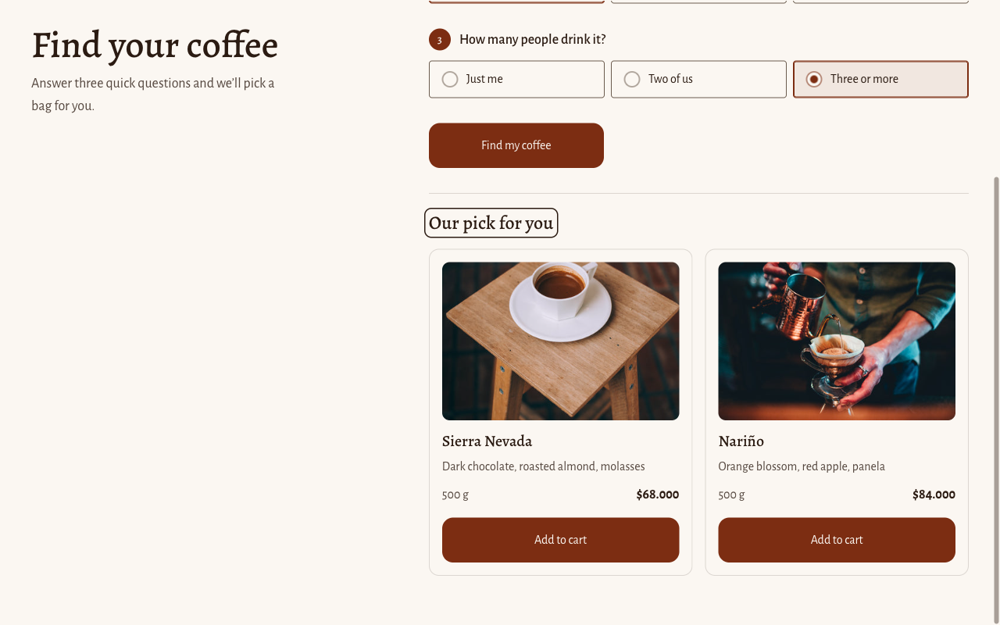

<details>
<summary>All storefront screenshots (offline preview, 390 × 844 and 1280 × 800)</summary>

| | 390 × 844 | 1280 × 800 |
| --- | --- | --- |
| Coffee finder | 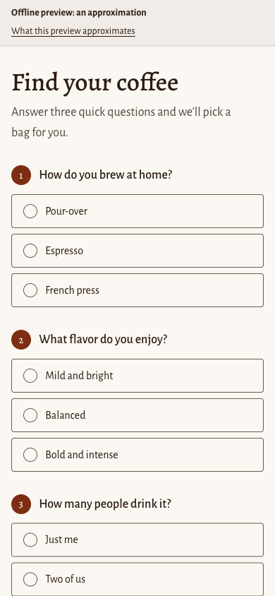 | 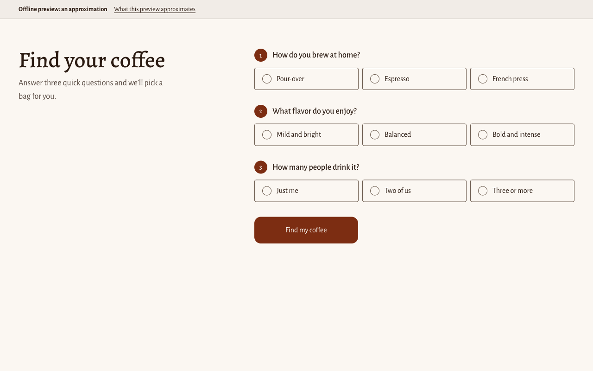 |
| Finder results | 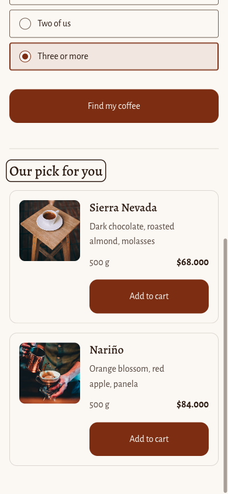 |  |
| Cart at 0% | 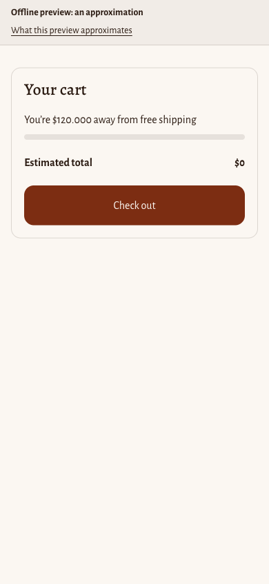 | 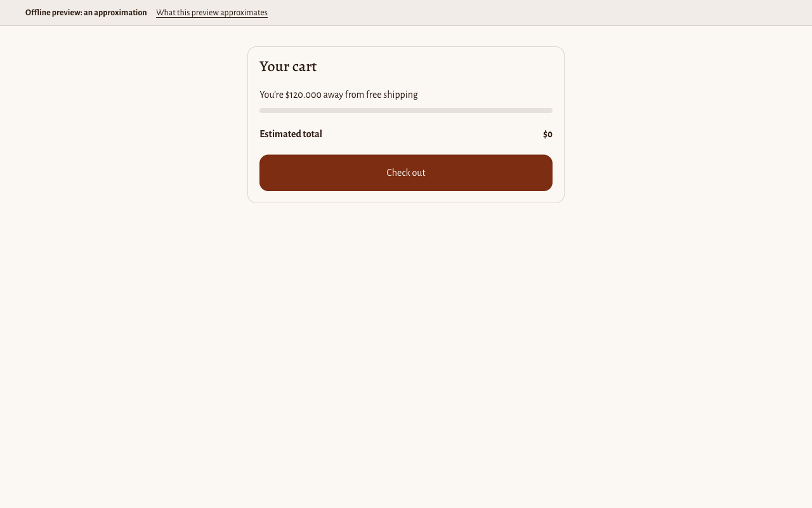 |
| Cart at 60% | 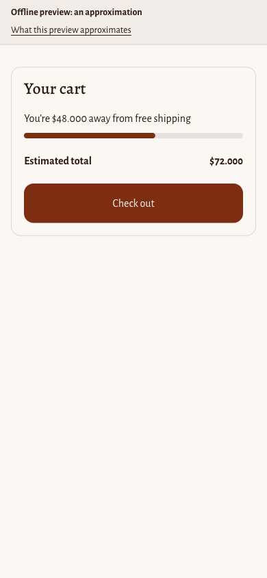 | 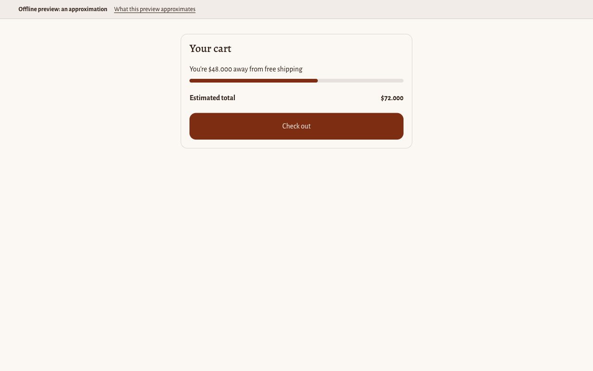 |
| Cart at 100% | 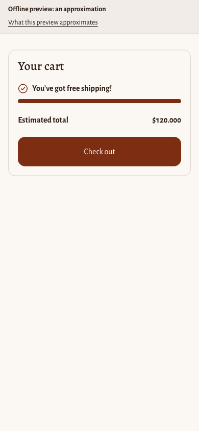 | 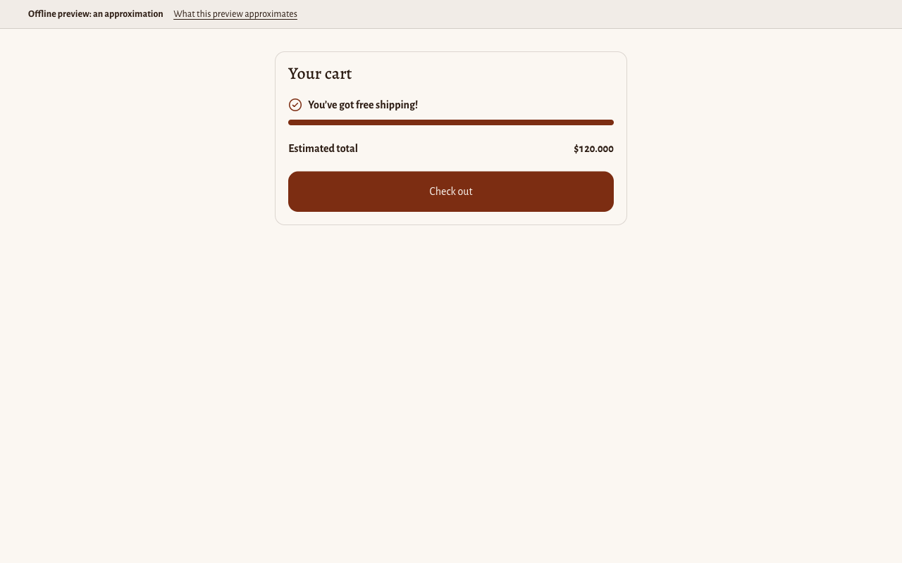 |
| Coffee finder, Spanish | 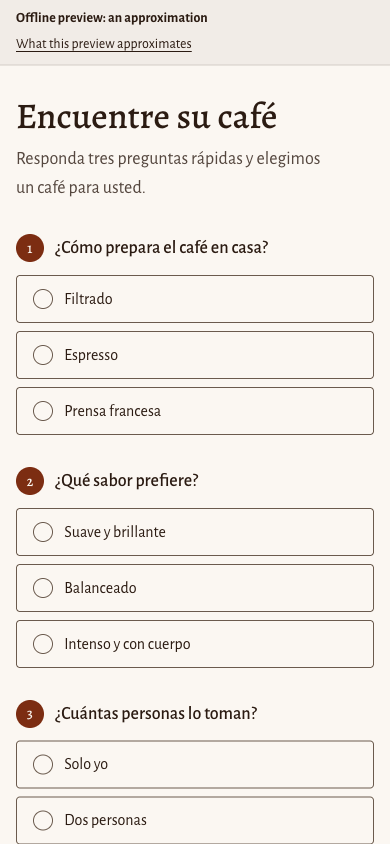 | 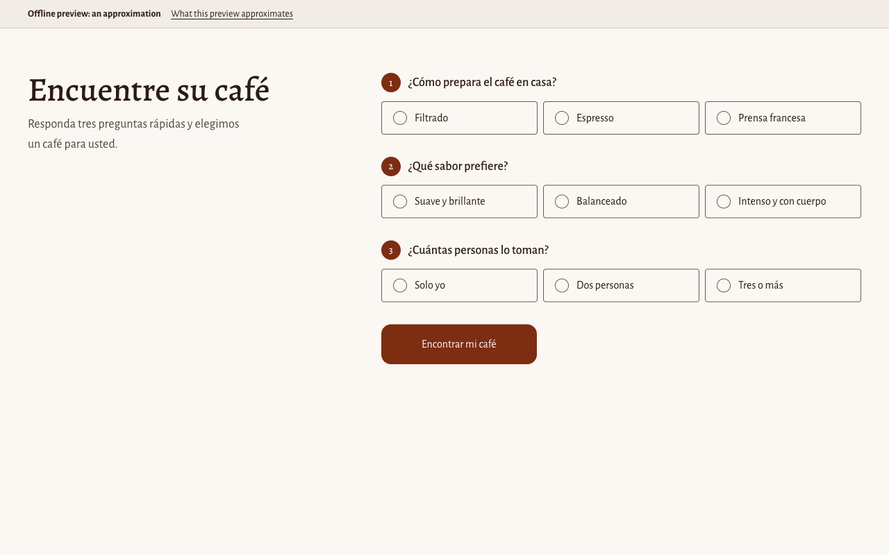 |
| Finder results, Spanish | 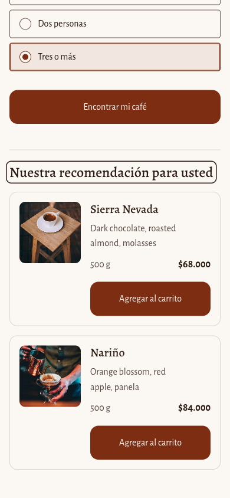 | 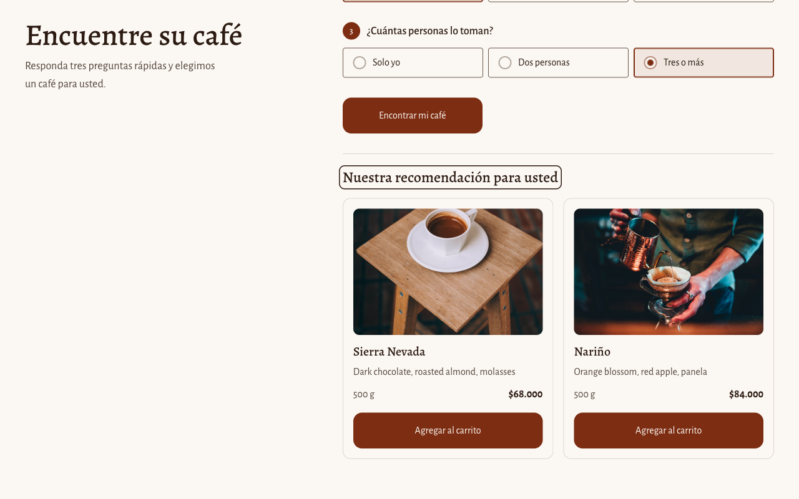 |
| Cart at 60%, Spanish | 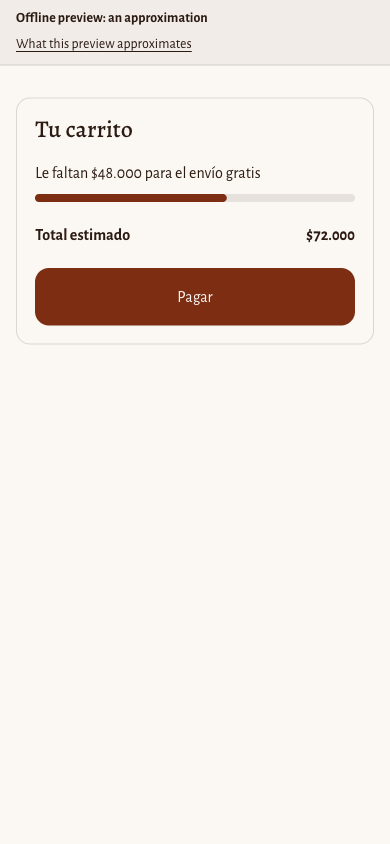 | 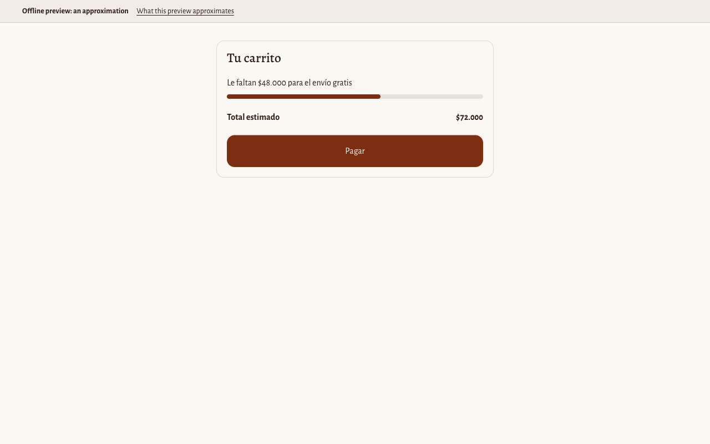 |

</details>

## Quick start

```sh
node scripts/init-env.ts   # writes .env with fresh local secrets; leaves ngrok/Shopify/Google blank
cp config/config.example.json config/config.json

docker compose up -d --wait
curl -s localhost:5678/healthz
pnpm run setup
```

n8n is then at <http://localhost:5678>. Fill in the blank third-party values (ngrok, Shopify, Google OAuth) in `.env` by hand before relying on anything that needs them; `init-env.ts` already generated the local secrets (Postgres roles, `N8N_ENCRYPTION_KEY`, `DEV_HARNESS_TOKEN`) — see `.env.example` for what's required.

Already running a local stack from before `db/migrations/` or `app_runtime` existed? Follow `docs/database.md`'s "Upgrading an existing local stack" instead of starting over — it includes the one-time `pnpm run setup -- --refresh nbcCredAppDb0001` the `App DB` credential needs on an existing volume.

## Languages

English is the source language; Spanish lives only in translation files and message tables.

- **Storefront.** Shopify picks the language per visitor. The theme's strings are in `theme-locales/` (see [`theme/README.md`](theme/README.md#translations)); product content is translated in Shopify's Translate & Adapt app.
- **Customer emails.** The brewing guide is written in the order's own `customer_locale`; set `default_locale` in `config/config.json` (`en` or `es`, default `en`) for orders without one. The guide's text is in `data/brewing-guides.json`: English at each guide's top level, Spanish under `translations.es`.
- **Owner emails.** Set `team_locale` (`en` or `es`, default `en`) to switch the order summary, low-stock, and error alerts.
- **Adding a language** takes a translation file per platform: `theme-locales/<code>.json` and `<code>.schema.json` for the theme, a `translations.<code>` entry per brewing guide, a message-table entry in each email Code node (`src/nodes/select-guides.ts`, `owner-summary.ts`, `select-low-stock.ts`, `error-alert.ts`), and the code in `src/lib/locale.ts`'s `LOCALES`. `AGENTS.md`'s "Languages" section lists the steps.

## Limitations

Deliberate simplifications, each with its ceiling and upgrade path:

- **`intake-order` processes only the first order of a call.** `Process order`'s input reads `.first()` off `Normalize order`'s output, which is exact as long as a webhook call carries exactly one order, as it does today. A future caller that hands `intake-order` more than one item at once would still only process the first of them. Upgrade path: read the order from the current item (`.item`) instead of always taking the first one.
- **Shopify gets its HTTP 200 before the order is recorded.** The Shopify Trigger answers on receipt, before `Hand to intake` or anything inside `intake-order` runs. A failure past that point — a database outage, a bad hand-edited config — never shows up to Shopify as anything but success; it's visible only in n8n's own executions list, not in a delivery status.
- **A lost `Record order` response can strand an order with no alert.** If the INSERT actually commits but its response never reaches n8n before a retry runs, the retry's `ON CONFLICT DO NOTHING` suppresses it, reporting the same `{success: true}` a genuine duplicate would — so the order looks already handled even though nothing downstream of the gate ever ran. See `AGENTS.md`'s recovery steps.
- **"Read stock and brew methods" has no per-request timeout.** The GraphQL node (unlike HTTP Request) exposes no `options.timeout`, so a hung Shopify response blocks this execution until n8n's own default times it out, rather than failing fast on a bounded ceiling. Upgrade path: switch to the HTTP Request node with `options.timeout` plus an explicit `errors` check, trading the GraphQL node's built-in throw-on-`errors` behavior for a manual one.
- **A wait shorter than 65 seconds doesn't survive a restart.** n8n 2.45.6 only persists a Wait node's sleep past `MAX_IN_PROCESS_WAIT_MS`; anything shorter stays in the process's own memory and is lost if n8n restarts mid-wait. `guide_delay_minutes` is validated at 2 or more precisely because of this ceiling. Upgrade path: none needed at this delay — it's n8n's own design, not something this repo works around.
- **Queue mode's Redis has no password.** `compose.queue.yaml` publishes no Redis port, so only containers on the Compose network can reach it, but any of them can. Upgrade path: set `QUEUE_BULL_REDIS_PASSWORD` before running queue mode in production.
- **`pnpm run setup` waits 15 seconds after restarting n8n, then polls the dev harness's webhook until it's registered.** `/healthz` reports healthy before the publication reconciler syncs the published versions, every 10 seconds by default. The webhook poll proves the harness is live, not that every sub-workflow already runs its newest published version under a slower reconciler. Upgrade path: poll `workflow_published_version` against `workflow_entity.activeVersionId` instead of the fixed wait.
- **Product content stays English until Translate & Adapt runs.** Titles, tasting notes, and variant names come from the store's own data, so a Spanish storefront and a Spanish guide email show them as entered until they're translated in Shopify.
- **Horizon's own strings use *tú*; this repo's use *usted*.** Horizon's Spanish locale addresses the customer informally (for example "Tu carrito"), while every string added here uses the formal *usted*. Upgrade path: override those Horizon keys in `theme-locales/es.json` if the store wants one register throughout.
- **The free-shipping bar can disagree with checkout.** It reads `cart.total_price`, which is the total after cart-level discounts but before anything applied at checkout. A discount code entered at checkout can still take the order below the free-shipping rate after the bar has already shown "You’ve got free shipping!".

## Live checks (pending)

These need the owner's existing Google account, so they aren't run yet:

- **Gmail re-consent.** Run `pnpm run setup -- --refresh nbcCredGmail0001` and re-authorize the Gmail credential in the n8n editor; the Google consent screen should show only "Send email on your behalf", not the broader mailbox access n8n's default scope set would otherwise imply. The old, broader grant stays valid until it's revoked under your Google Account's [third-party access](https://myaccount.google.com/connections).

These need a live, `--live`-published `shopify-orders` trigger with a real Shopify credential, so they aren't run yet:

- A valid order (`pnpm run send-test-order -- --fixture below-threshold --order-id <digits>`) produces one "Shopify orders" execution, one "Intake order" execution, and one `orders` row.
- The same order sent again produces another "Shopify orders" execution, but that run's "Intake order" stops at "Is new order?"; the `orders` row count doesn't change.
- A signed test order (`--fixture free-shipping`) adds exactly one `Orders` row and sends one owner email. The row matches the first test in `tests/nodes/order-row.test.ts`, except `order_number` (`#T<digits>`).
- Deleting that order's `orders` row (`docker compose exec -T postgres sh -c "psql -U \"\$APP_DB_USER\" -d app -c \"DELETE FROM orders WHERE order_id = '<digits>'\""`, so the container expands `$APP_DB_USER` from its own environment, not the host's) and sending it again with the same `--order-id` updates its `Orders` row; it doesn't add a second one. n8n refuses to retry a successful execution, so this re-sends the order instead.
- An order whose shipping name is `=1+1` shows the literal text `=1+1` in the `customer` cell.
- An order whose shipping name is `| json` or contains `<!--` shows the literal text in the `customer` cell and the owner email body, with no n8n expression evaluated and no HTML comment swallowing the rest of the email.
- A tampered signature (`pnpm run send-test-order -- --tamper --order-id <digits>`) gets HTTP 200, starts no execution at all, and creates no row.
- In one real order's execution data, every field `normalize-order` reads is present (`admin_graphql_api_id`, `name`, `email`, `shipping_address.name`/`city`, `line_items[].variant_id`/`variant_title`/`sku`, `total_shipping_price_set`, `shipping_lines`). If a field moved, update the fixture and the mapper.
- **Low stock.** A real order of 2 × Sierra Nevada 500 g (stock 6) sends `Low stock after order <#>` with the line `Sierra Nevada (500 g), SKU NBC-SNV-500: 4 left (threshold 5)`. An order of Huila 250 g sends no alert.
- **Unknown variants.** A signed fixture order, whose variants don't exist in the store, sends no alert and doesn't fail.
- **Stock-read failure.** Setting `config.shopify.store` to a store subdomain that doesn't exist makes the stock read fail after its retries. The error workflow then emails the owner. After restoring the subdomain, the next order reads stock again. Retrying the failed run from the UI fails again, because a retry reuses the config the run started with.
- **Two methods.** With `guide_delay_minutes: 2`, a real order of Nariño 250 g plus Sierra Nevada 250 g gets one email, about 2 minutes later, with Pour-over and Espresso sections.
- **Restart during the wait.** Restarting n8n (`docker compose restart n8n`) during a wait still delivers the guide.
- **No email address.** An order without one sends no guide and doesn't fail.
- **Real delay.** With `guide_delay_minutes` back at 60, one order's guide arrives about an hour later. n8n shows the execution as waiting until then.
- **Live file edits.** Editing a step in `data/brewing-guides.json` changes the next guide, with no re-import.
- **Spanish guide.** A real order placed on the Spanish storefront carries `customer_locale` `es` (or `es-CO`), and its guide arrives in Spanish ("Cómo preparar su café Nubandina"). An order placed in English gets the English guide.
- **Error alert in n8n.** The stock-read failure above sends its alert through `Collect alert input` and `Build error alert`, with the same English text as before, and in Spanish once `team_locale` is `es`.
- **Team locale.** With `team_locale: "es"`, the next order's summary reads "Nuevo pedido …" with amounts like `96.000 COP`, and a low-stock alert reads "Inventario bajo tras el pedido …".
- **Subscription cycle.** After `pnpm run setup -- --live`, `GET /admin/api/2026-10/webhooks.json` shows a new subscription ID.

These need the ngrok tunnel, or queue mode with the live trigger, so they aren't run yet:

- **Tunnel.** Through the public ngrok URL, `/`, `/rest/login`, `/webhook-test/x`, `/webhook/dev/x`, and `//webhook/x` each return 404, and only the trigger's own path reaches n8n.
- **Rate limit.** A burst of unsigned POSTs to the tunnel's own path gets HTTP 429 once it exceeds the policy's capacity, and a signed `pnpm run send-test-order` right after still makes exactly one "Shopify orders" execution.
- **Queue mode.** With `compose.queue.yaml` and two workers, a signed order runs on a worker and adds its `Orders` row.
- **Container hardening.** With `compose.queue.yaml` added, `docker inspect` on the `ngrok`, `redis`, and `n8n-worker` containers shows `no-new-privileges:true`; the queue-mode `n8n-worker` also shows `CapDrop: ["ALL"]`, inherited from the `n8n` service it extends.

These need `pnpm dlx @shopify/cli@5.0.0 theme dev` against `.theme-build/theme`, so they aren't run yet:

- **Drawer.** With Sierra Nevada 250 g in the cart, it shows "You’re $82.000 away from free shipping" at 31%.
- **Live updates.** Raising the quantity to 4 (152,000 COP) switches it to "You’ve got free shipping!" without a reload, in the drawer and on `/cart`. Lowering it again restores the remaining message.
- **Boundary.** Huila 250 g plus Huila 500 g (exactly 120,000 COP) shows the reached message, and checkout charges 0 shipping.
- **Disabled.** A blank threshold, or unticking "Show the free shipping bar", hides the bar with no console errors.
- **Keyboard path.** Tab reaches each radio group and arrow keys move within it. Submitting "Pour-over / Mild and bright / Just me" moves focus to "Our pick for you", which shows one card: Nariño 250 g, its price, and its notes.
- **Unanswered question.** Submitting with only a brew method chosen marks the other two questions, announces "Choose an answer for each question.", and moves focus to the taste question.
- **Adding to cart.** "Add to cart" with Enter shows the busy ring, keeps focus on the button, opens the cart drawer, and the free-shipping bar reflects the new total.
- **Second option.** "Espresso / Mild and bright / Three or more" shows two cards, Sierra Nevada 500 g and then Nariño 500 g.
- **Theme editor.** The section can be added to another page, its texts edited, and the section removed, all without code.
- **No errors.** The console shows no errors, and `Shopify.actions` is present. Note it if it's absent: the Cart AJAX fallback then handles "Add to cart".
- **Spanish storefront.** With Spanish published, `/es` shows the finder and the free-shipping bar in Spanish; `theme/README.md` lists the translation checks.
- **Brand.** The theme editor shows the six palette colors and the Alegreya fonts, both fonts load from Shopify's font CDN, and Horizon's own muted text (the footer copyright) uses the raised 0.65 opacity.
