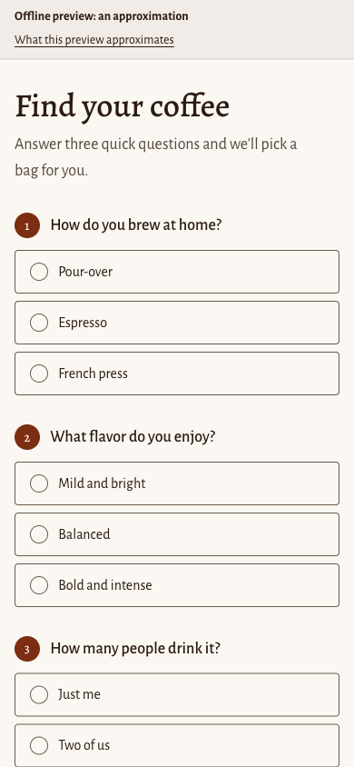
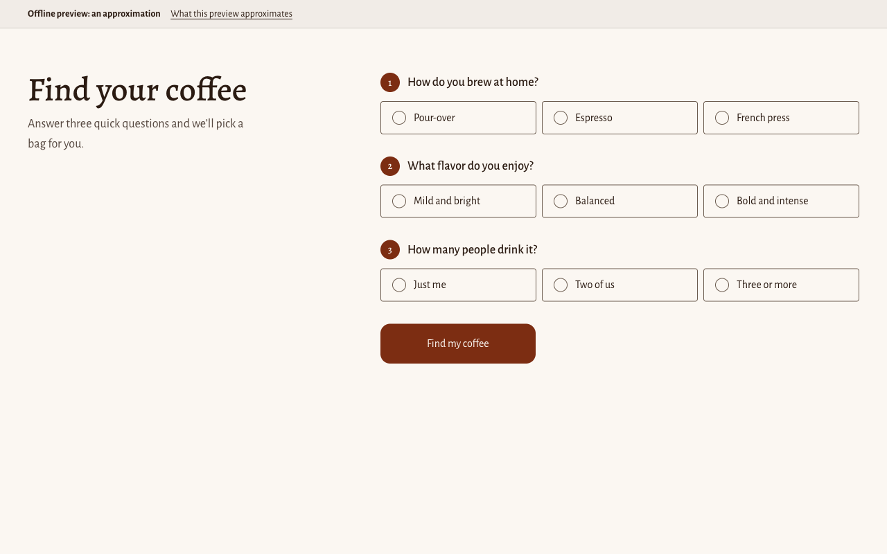
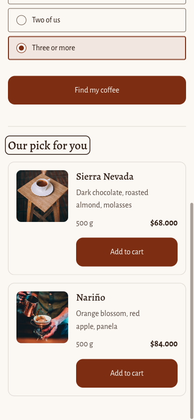
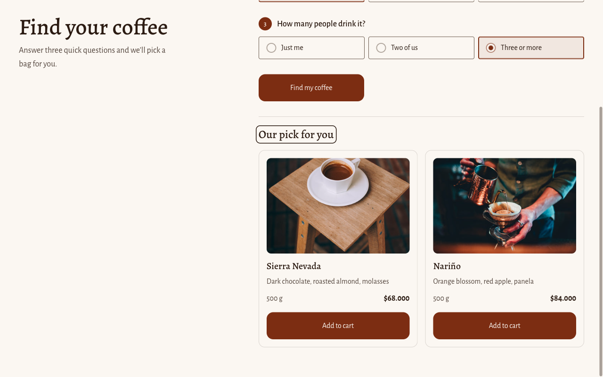
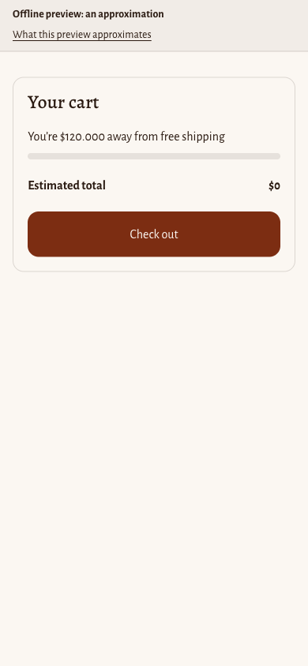
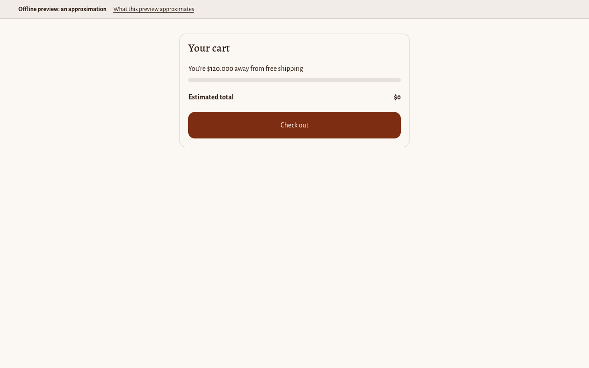
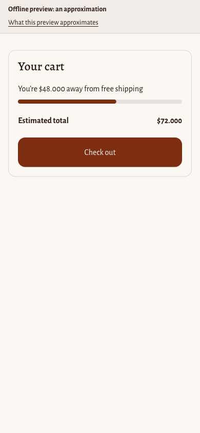
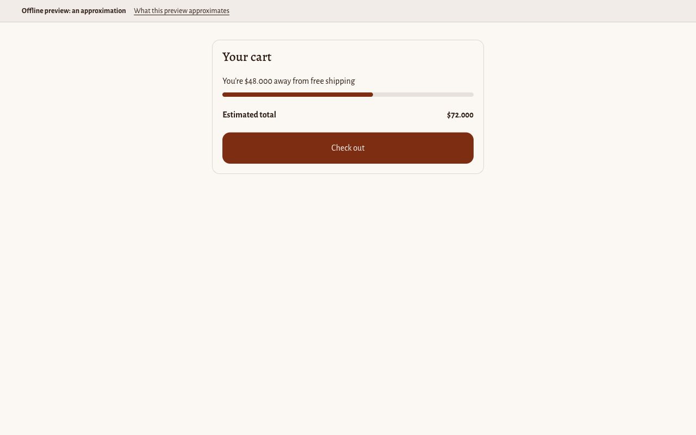
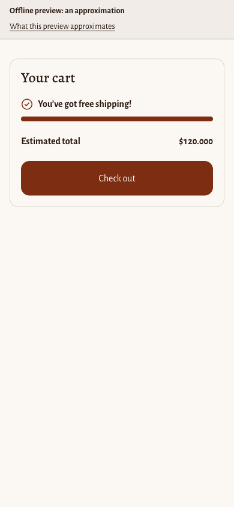
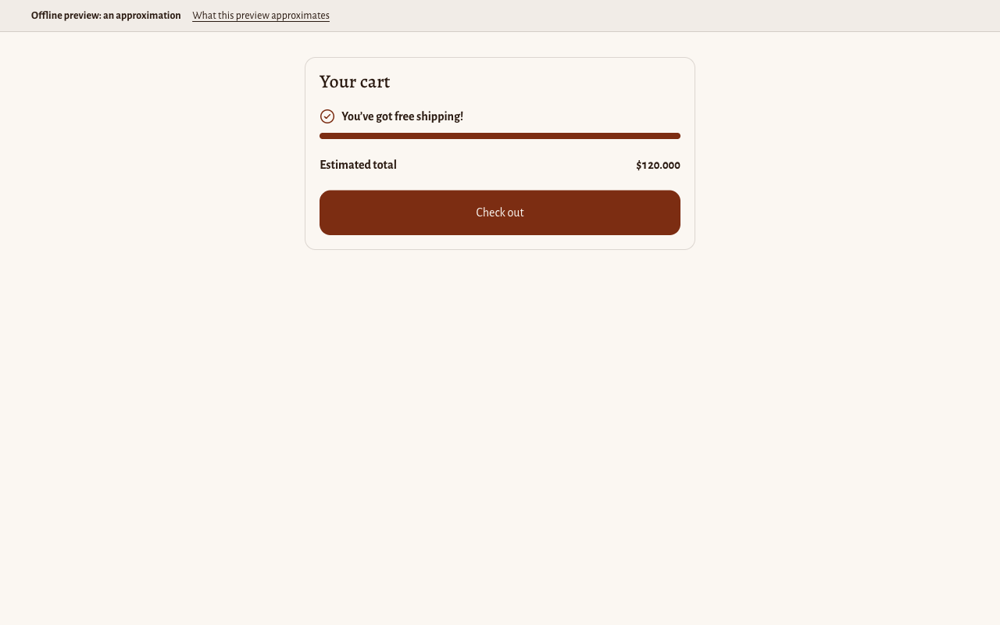

# Theme overlay

This directory holds everything this repo adds on top of Shopify's Horizon theme. It is never
pushed to a store on its own: `pnpm run theme:assemble` downloads the pinned Horizon commit,
copies this overlay onto it, and applies a short list of anchored insertions into Horizon's own
files, producing a complete, pushable theme at `.theme-build/theme/`.

## How assembly works

1. **Base.** `scripts/lib/horizon.ts` downloads Horizon at the exact commit pinned in `HORIZON`
   (`codeload.github.com/Shopify/horizon/tar.gz/<commit>`) and extracts it into
   `.theme-build/horizon-<commit>/`, reused on later runs instead of downloading again.
2. **Overlay.** `scripts/assemble-theme.ts` copies the base into a fresh `.theme-build/theme/`,
   then copies every file under this directory (`theme/**`) on top of it, except this README. A
   copied file that didn't already exist in Horizon is new (`added`); one that did is a deliberate
   override (`modified`).
3. **Insertions.** `scripts/lib/theme-insertions.ts`'s `INSERTIONS` list makes small, surgical
   edits to Horizon's own files that a whole-file overlay can't express: a line inserted before an
   exact anchor, an exact anchor replaced, a settings group appended once, a section added once to
   a JSON template, or theme settings changed in `config/settings_data.json`. Each insertion names
   the file and either an anchor string (which must appear in it exactly once), a key that must not
   already exist, or the exact current value of each setting it changes; a mismatch fails assembly
   immediately and names the file and anchor, rather than silently applying to the wrong spot or
   duplicating. Every touched file counts as `modified`.

The free-shipping bar, the coffee finder, and the brand (below) fill these lists. A new feature adds
its theme files and insertions the same way, and documents the exact file, anchor, and content
here.

## TypeScript assets

Browser-facing TypeScript lives in `src/theme/`. `scripts/build-theme.ts`'s `THEME_ENTRIES` list
maps each entry point to the asset name it bundles into; `pnpm run build:theme` runs esbuild
(bundled, ESM, not minified — Shopify serves theme assets minified at request time, so shipping
already-minified code would just double-minify it) and writes `theme/assets/<asset>`, with a
generated-file banner naming the source to edit instead. `pnpm run build:theme -- --check` reports
drift and exits 1 without writing; that's what CI runs.

## Free shipping bar

A progress bar in the cart drawer and on `/cart` showing how far the cart is from the free
shipping threshold, updating live as the cart changes.

**Files:**

- `src/theme/money.ts` — `formatMoney(cents, format)`, a small formatter for Shopify's
  `shop.money_format` placeholders (`amount`, `amount_no_decimals`, and their comma/space/period/
  apostrophe-separator variants). Pure, unit-tested (`tests/theme/money.test.ts`).
- `src/theme/free-shipping.ts` — `freeShippingProgress(totalCents, thresholdCents)` and
  `barMessage(state, messages, moneyFormat)`: the bar's own math and copy, with no DOM. Pure,
  unit-tested (`tests/theme/free-shipping.test.ts`).
- `src/theme/free-shipping-bar.ts` — the `<free-shipping-bar>` custom element. Bundled by
  `THEME_ENTRIES` into `theme/assets/free-shipping-bar.js` (generated; never hand-edited).
- `theme/snippets/free-shipping-bar.liquid` — renders the `<free-shipping-bar>` markup from the
  Theme contracts' DOM contract, reads the settings below, and loads the bundled script. The first
  render is server-side: the message, the fill, `aria-valuenow`, `aria-valuetext`, and
  `data-state` (`remaining` or `reached`) are already right before the script runs, so nothing
  starts empty or shifts.

**Insertions** (`scripts/lib/theme-insertions.ts`'s `INSERTIONS`):

1. `snippets/cart-summary.liquid`: a `before-line` insertion of ``
   on its own line, anchored immediately before `<div class="cart-totals">` (that line appears
   exactly once in Horizon's file).
2. `config/settings_schema.json`: an `append-settings-group` insertion adding the group "Free
   shipping bar" with five settings: `free_shipping_bar_enabled` (checkbox, default on),
   `free_shipping_threshold` (number, default 120000), `free_shipping_message_remaining` (text,
   `[amount]` placeholder), `free_shipping_message_reached` (text), and
   `free_shipping_progress_label` (text, the progress bar's accessible label).

**States and accessibility.** The track is a `role="progressbar"` with `aria-valuenow` (the
percent), `aria-valuetext` (the same message the bar shows), and the progress label setting as its
name. At the threshold, `data-state="reached"` shows a check icon (inline SVG, `aria-hidden`, since
the message already says it) and sets the message in bold. The fill is a full-width bar slid into
place with `transform`, transitioned only under `prefers-reduced-motion: no-preference`. The script
writes the message and attributes only when they change, so the polite live region doesn't
re-announce what the server already rendered.

**Staying live.** The bar updates two ways: it listens on `document` for
`shopify:cart:lines-update` and re-reads `/cart.js` once the event's own promise settles, and it
also re-renders from `data-total-cents` whenever that attribute changes — which Horizon's section
morph sets on every cart update regardless of the event, since the morph copies an element's
attributes even where `data-skip-subtree-update` keeps it from touching that element's children.

**Limitations:**

- The bar reads `cart.total_price`, which reflects cart-level discounts but not anything applied
  at checkout. A discount code entered at checkout can still take the order below the free
  shipping rate after the bar has already shown "You’ve got free shipping!".

## Coffee finder

A home-page section that asks three questions (brew method, taste, party size), recommends one or
two coffees from product metafields, and adds the chosen bag to the cart.

**Files:**

- `src/theme/recommend.ts` — `recommend(products, answers)` and its helpers `readAnswers` and
  `parseProducts`: scores each available product (+2 for a brew-method match, +1 for a
  taste-to-roast match via `TASTE_TO_ROAST`), keeps up to two, preferring an exact score-3 match
  over a partial one, and picks each product's lightest available variant for 1–2 people or its
  heaviest for 3, first on a tie. Pure, unit-tested (`tests/theme/recommend.test.ts`).
- `src/theme/shopify-actions.d.ts` — ambient types for the platform-provided `Shopify.actions`
  (`updateCart`, `openCart`), declaring only the members this theme calls, including
  `UpdateCartResult`'s `userErrors` and `warnings`.
- `src/theme/coffee-finder.ts` — the `<coffee-finder>` custom element. Bundled by `THEME_ENTRIES`
  into `theme/assets/coffee-finder.js` (generated; never hand-edited). Renders with `textContent`
  only.
- `theme/sections/coffee-finder.liquid` — the section markup from the Theme contracts' DOM
  contract: the three-question form, the results region, the card `<template>`, and the embedded
  product JSON (up to 50 products from the configured collection, or every product when it's
  blank), reads the settings below, and loads the bundled script. It sits in Horizon's own
  `section section--page-width` grid, so it gets the theme's page margins.

**Layout and states.** Mobile first: each answer is a full-width option at least 48px tall, the
whole option clickable; from 750px the three answers sit side by side, and from 990px the intro
stays beside the form. A chosen option takes the primary color as its border and a light tint.
Submitting with a question unanswered marks that question's options, sets `aria-invalid` and
`aria-describedby` on its radios, shows the "Unanswered question message" setting in a
`role="alert"` region beside the button, and moves focus to the first unanswered question; answering
it clears the mark. Results come in as cards (image, linked title, notes, size, price, and an "Add
to cart" button); with no match, the "No match text" shows with a link to every coffee. While an
add is in flight, the button shows a small spinning ring (static under reduced motion). The card's
status line says whether the add worked, styled by `data-state="success"` or `"error"`.

**Insertions** (`scripts/lib/theme-insertions.ts`'s `INSERTIONS`):

3. `templates/index.json`: an `add-section-after` insertion adding section `coffee_finder`
   (`{ "type": "coffee-finder", "settings": {} }`) right after `hero_jVaWmY` in `order`, keeping the
   file's leading `/* ... */` comment intact.

**Embedding product data safely.** Each product's title, image alt text, and metafield values are
merchant-controlled text, written into `script[type="application/json"][data-finder-products]` with
Liquid's `json` filter. shopify.dev's `json` filter docs promise only that it escapes quotes, say
nothing about `<`, `>`, or `/`, and Horizon's own existing `| json` usages (for example
`snippets/variant-swatches.liquid`) embed the same way with no extra escaping — so a tasting note
containing a literal `</script>` isn't guaranteed safe by the filter alone. The section captures the
JSON first, then runs it through `| replace: '</', '<\/'` before writing it into the script tag,
which breaks any embedded closing-tag sequence while leaving `JSON.parse` able to read it back
unchanged (`\/` parses back to `/`). The runtime reads the script with `JSON.parse(script.textContent)`
and renders every field with `textContent`, never `innerHTML`.

**Adding to cart.** `coffee-finder.ts` prefers the platform's `Shopify.actions.updateCart`, passing
the chosen variant and `{ event: { context: 'standard-action' } }`; a non-empty `userErrors` shows
the configured error text. Otherwise it shows the added text, followed by any `warnings` messages
(such as an adjusted quantity), and then opens the cart; a failure to open the cart only logs a
console warning, so it can't turn a real add into a reported error. When `Shopify.actions` is
absent, it falls back to the Cart AJAX API (`POST ${cartAddUrl}.js`), navigating to the cart only
on an OK response and otherwise showing the error text. A thrown or rejected call either way also
shows the error text and re-enables the add button.

**Accessibility.** Each question is a native `<fieldset>` with a `<legend>` and radio inputs (the
question number before each legend is CSS-generated with empty alternative text, so it isn't read
out); the whole option shows the focus ring, and the radio's own ring is dropped only where
`:has()` can draw that replacement. The results region is `aria-live="polite"`; submitting moves
focus to the results heading (`tabindex="-1"`, since it isn't otherwise focusable), which shows a
focus ring when reached by keyboard. Each card's title is a link to the product. The add button
sets `aria-busy` while the request is in flight, instead of `disabled`, which would drop keyboard
focus to the page; a second press while busy does nothing. Each card's add button carries the
product and variant name in a visually-hidden span inside it, so its accessible name names the
coffee, and its status line is a `role="status"` region. The card template's image has `alt=""`.

**Limitations:**

- The busy state keeps the button's label as it is and adds only the ring and `aria-busy`, which
  not every screen reader announces; the status line's "Added to your cart." (or the error) is what
  confirms the result.
- The product list is capped at 50 products (`| slice: 0, 50`), reflecting the catalog this demo
  ships with. A larger catalog would need pagination or a narrower collection setting instead of
  reading every product on every page load.

## Brand

Nubandina's look comes from Horizon's own theme settings, not from component CSS: the components
read Horizon's CSS variables, which these settings fill in, so every Horizon section and both
components change together, and the merchant can still adjust them in the theme editor.

**Insertions** (`BRAND_SETTINGS` and the muted-text entry in `INSERTIONS`):

4. `config/settings_data.json`: a `set-theme-settings` insertion on the `current` settings. Each
   change names the exact value Horizon v4.3.0 ships (or that the setting must be unset), so a
   Horizon update that changes any of them fails assembly instead of mixing two designs. Every
   setting it touches must still be declared in `config/settings_schema.json`.
5. `snippets/theme-styles-variables.liquid`: a `replace-anchor` insertion of
   `--opacity-muted-text: 0.6;` with `0.65`, explained under Contrast below.

**Palette.** Horizon 4.3.0 has no color schemes: it has one `color_palette` setting, and every
other color setting defaults to a reference into it, such as `{{ settings.color_palette.foreground }}`.
The brand keeps Horizon's own keys and roles:

| Key | Color | Role in Horizon |
| --- | --- | --- |
| `background` | cream `#FBF7F2` | page, inputs, drawers, secondary buttons |
| `foreground` | espresso `#2B1B12` | text, borders, focus rings |
| `color1` | roast `#7C2D12` | primary buttons and selected variants (set below) |
| `color2` | sand `#E7DCCD` | the sold-out badge's background; decorative only |
| `color3` | muted `#6B5B4E` | input and variant borders |
| `color4` | leaf `#3F6212` | new; for small badges only |

`palette_primary_button_background`, `palette_primary_button_border`,
`palette_selected_variant_background`, and `palette_selected_variant_border` point at `color1`.
Their text colors keep Horizon's defaults (`background`).

**Fonts.** All four come from Shopify's font library; each handle was checked against the list at
[shopify.dev's font library page](https://shopify.dev/docs/storefronts/themes/architecture/settings/fonts#available-fonts).

| Setting | Handle | Font |
| --- | --- | --- |
| `type_heading_font` | `alegreya_n5` | Alegreya Medium, a calligraphic serif |
| `type_accent_font` | `alegreya_n7` | Alegreya Bold |
| `type_body_font` | `alegreya_sans_n4` | Alegreya Sans, its humanist sans companion |
| `type_subheading_font` | `alegreya_sans_n5` | Alegreya Sans Medium |

`type_size_paragraph` goes from 14 to 16: Alegreya Sans has a small x-height, so 14px body text
reads closer to 12px.

**Contrast.** Every pair meets WCAG AA; `tests/theme/brand.test.ts` asserts each one:

| Pair | Ratio |
| --- | --- |
| Body text: espresso on cream | 15.52:1 |
| Secondary text: muted on cream | 6.09:1 |
| Horizon's muted text, espresso at 65% on cream | 5.06:1 |
| Horizon's subdued text, espresso at 80% on cream | 8.34:1 |
| Primary button: cream on roast (hover: cream on `#923515`) | 8.79:1 (7.18:1) |
| Sold-out badge: espresso on sand | 12.23:1 |
| Small badge: cream on leaf | 6.64:1 |
| Control borders: muted on cream (needs 3:1) | 6.09:1 |
| Selected option and progress fill: roast on cream (needs 3:1) | 8.79:1 |

Horizon draws muted text as the foreground at `--opacity-muted-text: 0.6`, which measures 4.32:1
on the cream background, so the brand raises it to 0.65 (5.06:1), the smallest step that passes.
Sand on cream (1.27:1) is decorative only.

## Offline preview

`pnpm run theme:preview` assembles the theme, then renders the real
`sections/coffee-finder.liquid` and `snippets/free-shipping-bar.liquid` from
`.theme-build/theme/` with [liquidjs](https://liquidjs.com/) (a devDependency, used only here) and
writes `.theme-build/preview/index.html` (gitignored), next to copies of Horizon's
`assets/base.css` and the two built component scripts. Serve it and open it in a browser:

```sh
pnpm run theme:preview
python3 -m http.server 8765 --directory .theme-build/preview
```

`?demo=finder`, `?demo=cart-0`, `?demo=cart-60`, and `?demo=cart-100` show one state at a time.

**It is an approximation, and the page says so.** Shopify's own renderer, its font CDN, its section
wrapper, and a real cart can all differ; the real check is `shopify theme dev` against a store (see
"Pushing to a store" below). What it does instead:

- **Mock data** (`scripts/lib/theme-preview.ts`'s `parseCatalog`): `data/products.csv` shaped into
  the `product` objects the finder's Liquid reads, with synthetic ids (products from 1001,
  variants from 2001), prices in cents, availability from stock and the selling policy, the first
  row's image and alt text, and the three `coffee` metafields. `section.settings` comes from the
  section's own `` defaults, `settings` from the assembled `settings_schema.json`
  defaults overlaid with `settings_data.json`'s `current` values (palette references resolved),
  `shop.money_format` is `${{amount_no_decimals_with_comma_separator}}` (from
  `docs/shopify-setup.md`), and `cart.total_price` is 0%, 60%, and 100% of the threshold.
- **CSS variables:** the Liquid-free lines of Horizon's `snippets/theme-styles-variables.liquid`
  `:root` block are copied verbatim; the settings-driven ones the components rely on (colors,
  button and input colors, fonts and type presets, radii) are computed from the settings by
  `themeCssVariables`, following Horizon's Liquid formulas for opaque colors.
- **Fonts:** the same families, Alegreya and Alegreya Sans, load from Google Fonts instead of
  Shopify's font CDN.
- **Product images** load straight from the CSV's Shopify CDN URLs (`burst.shopifycdn.com`).

**Stubs.** Only these Shopify-only tags and filters are stubbed, and the engine runs with
`strictFilters`, so a component that starts using any other Shopify-only filter fails the preview
instead of rendering wrongly:

| Stub | What it does in the preview |
| --- | --- |
| `` | Prints nothing; the preview reads its defaults separately. |
| `` | Prints nothing in place; its CSS goes once into the page's `<head>`, as Shopify bundles it. |
| `` | Prints nothing. |
| `money` | Formats cents with the same `formatMoney` the bar's script uses, in the store's format. |
| `asset_url` | Returns `assets/<name>`, next to the page. |
| `image_url` | Returns the image's URL with its `width` parameter set. |
| `window.Shopify.actions` | A preview-only stand-in on the page: `updateCart` resolves after 800 ms with no errors, so the add button's busy and added states can be seen; `openCart` does nothing. |

Everything else (`escape`, `json`, `strip`, `replace`, `replace_first`, `slice`, `times`,
`divided_by`, `minus`, `floor`, `at_least`, `at_most`, ``, ``, and the
rest) is liquidjs's own standard Liquid, with two known differences from Shopify: liquidjs reads
`'<\/'` in the finder's `replace` as `</`, so the preview skips that `</script>` guard (the mock
data contains no `</`), and its `divided_by` doesn't truncate two integers, which the bar's
`| floor` makes moot.

`tests/theme/preview.test.ts` covers the mock shaping, the settings resolution, the color math
(checked against shopify.dev's own `color_lighten` example), the type sizes, each stub, and a
render of both real component files.

## Screenshots

From the offline preview, so an approximation of the storefront (see above). Each is 390 × 844 and
1280 × 800.

| | 390 × 844 | 1280 × 800 |
| --- | --- | --- |
| Coffee finder |  |  |
| Finder results |  |  |
| Cart at 0% |  |  |
| Cart at 60% |  |  |
| Cart at 100% |  |  |

## Theme check

`pnpm run theme:check` assembles the theme and runs Shopify's theme check
(`@shopify/theme-check-node`) against it. An error (severity 0) anywhere is always a release
blocker. So is any offense — any severity — in a file this repo added or modified, since those are
ours to fix. Everything else is Horizon's own baseline: unmodified Horizon warnings that
`theme-check-node` can report differently between runs with no change in this repo, because it
loads the Liquid docs it checks against from `Shopify/theme-liquid-docs@main` at run time (with a
bundled fallback). The gate is `failing: 0`; the baseline count is printed and recorded here as
informational, not asserted.

At the time of writing, an unmodified pinned Horizon reports 0 errors and a baseline of 6
warnings, all in `sections/header.liquid` and `snippets/divider.liquid`. The brand's two
insertions make `config/settings_data.json` and `snippets/theme-styles-variables.liquid` this
repo's files too, so any offense in them now fails the check; neither has one.

## Commands

- `pnpm run theme:assemble` — assembles the theme into `.theme-build/theme/` and prints the added
  and modified file lists.
- `pnpm run build:theme [-- --check]` — bundles `THEME_ENTRIES` into `theme/assets/`; `--check`
  reports drift and exits 1 instead of writing.
- `pnpm run theme:check` — assembles, then runs theme check; prints any failing offenses and the
  baseline count, and exits 1 on any failure.
- `pnpm run theme:preview` — assembles, then writes the offline preview to
  `.theme-build/preview/index.html` (see "Offline preview" above).

## Pushing to a store (deferred live check)

These need a real dev store, so they haven't been run yet:

```sh
pnpm dlx @shopify/cli@5.0.0 theme dev --store <store>.myshopify.com --path .theme-build/theme
pnpm dlx @shopify/cli@5.0.0 theme push --unpublished --theme "Nubandina demo" --path .theme-build/theme
```

`--theme` on `theme push --unpublished` names the new theme — without `--development`, the CLI's
own help says to use `--theme` to provide the new theme's name, and `--unpublished` alone creates
an unnamed one. On a password-protected dev store, `theme dev` also needs
`--store-password <value>`.

Confirmed against `pnpm dlx @shopify/cli@5.0.0 theme push --help` and `theme dev --help`:

```
-t, --theme=<value>
    Theme ID or name of the remote theme. Use --development, --live, --theme, or
    --unpublished in non-interactive environments. When using --unpublished
    without --development, use --theme to provide the new theme name.
    [env: SHOPIFY_FLAG_THEME_ID]
```

```
--store-password=<value>
    The password for storefronts with password protection.
    [env: SHOPIFY_FLAG_STORE_PASSWORD]
```

### Free shipping bar (deferred live checks)

These need `pnpm dlx @shopify/cli@5.0.0 theme dev` against `.theme-build/theme`, so they haven't been
run yet:

- **Drawer.** With Sierra Nevada 250 g in the cart, it shows "You’re $82.000 away from free
  shipping" at 31%.
- **Live updates.** Raising the quantity to 4 (152,000 COP) switches it to "You’ve got free
  shipping!" without a reload, in the drawer and on `/cart`. Lowering it again restores the
  remaining message.
- **Boundary.** Huila 250 g plus Huila 500 g (exactly 120,000 COP) shows the reached message, and
  checkout charges 0 shipping.
- **Disabled.** A blank threshold, or unticking "Show the free shipping bar", hides the bar with no
  console errors.
- **Screen reader.** VoiceOver reads the bar as "Progress toward free shipping" with its message as
  the value, and announces the new message once after a cart change, not on page load.

### Coffee finder (deferred live checks)

These need `pnpm dlx @shopify/cli@5.0.0 theme dev` against `.theme-build/theme`, keyboard only, with
Chrome DevTools open, so they haven't been run yet:

- **Keyboard path.** Tab reaches each radio group and arrow keys move within it. Submitting
  "Pour-over / Mild and bright / Just me" moves focus to "Our pick for you", which shows one card:
  Nariño 250 g, its price, and its notes.
- **Unanswered question.** Submitting with only a brew method chosen marks the other two questions,
  announces "Choose an answer for each question.", and moves focus to the taste question.
- **Adding to cart.** "Add to cart" with Enter shows the busy ring, keeps focus on the button,
  opens the cart drawer, and the free-shipping bar reflects the new total.
- **Second option.** "Espresso / Mild and bright / Three or more" shows two cards, Sierra Nevada
  500 g and then Nariño 500 g.
- **Theme editor.** The section can be added to another page, its texts edited, and the section
  removed, all without code.
- **No errors.** The console shows no errors, and `Shopify.actions` is present. Note it if it's
  absent: the Cart AJAX fallback in `coffee-finder.ts` then keeps "Add to cart" working.

### Brand (deferred live checks)

These need `pnpm dlx @shopify/cli@5.0.0 theme dev` against `.theme-build/theme`, so they haven't been
run yet:

- **Theme editor.** Theme settings > Colors shows the six palette colors, and Typography shows
  Alegreya for headings and Alegreya Sans for body text.
- **Fonts.** Both families load from Shopify's font CDN, with no console errors and no fallback
  font in DevTools' rendered fonts.
- **Muted text.** Horizon's own muted text, such as the footer copyright, uses the 0.65 opacity.
